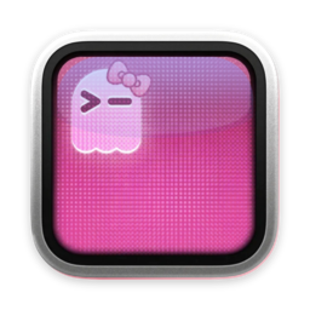

# Cute Ghostty

<p align="center">
  
</p>

<p align="center">
  <strong>The same Ghostty you love, but cuter.</strong><br>
  Cute pastel colours, adorable emojis, kawaii icon &mdash; same blazing-fast terminal.
</p>

<p align="center">
  <a href="https://github.com/amywork777/CuteGhostty/releases/latest/download/CuteGhostty.dmg">Download</a> &bull;
  <a href="https://cute-ghostty.vercel.app">Website</a> &bull;
  <a href="https://ghostty.org">Ghostty</a>
</p>

---

## What is this?

Cute Ghostty is [Ghostty](https://ghostty.org) with a cute makeover. It's the exact same terminal emulator under the hood &mdash; same GPU-accelerated rendering, same native macOS UI, same features &mdash; just with cute pastel colours, a kawaii icon, and adorable aesthetic touches.

[Ghostty](https://github.com/ghostty-org/ghostty) is an incredible open-source terminal emulator created by Mitchell Hashimoto. We just made it cuter.

## Download

Grab the latest published build: **[CuteGhostty.dmg](https://github.com/amywork777/CuteGhostty/releases/latest/download/CuteGhostty.dmg)**

The app bundle does not automatically track upstream Ghostty releases. For the
current upstream binary with Cute Ghostty styling, use the config-only option
below. Reports of [higher CPU usage](https://github.com/amywork777/CuteGhostty/issues/5)
and a [recurring memory leak](https://github.com/amywork777/CuteGhostty/issues/6)
in distributed app builds remain under investigation; rebuilding or installing
the config is not a verified fix for those reports.

1. Open the DMG and drag **Cute Ghostty.app** to your Applications folder
2. Launch and enjoy!

**Requirements:** macOS 13.0+ &bull; Universal binary (Apple Silicon + Intel)

## Or: just the config (themes, icon &amp; greeting)

Don't want to download an app? Apply the cute look to your *existing* Ghostty &mdash;
this is the "can it just be a config file?" path. You get the pastel themes, the
pink-screen icon, and an optional launch greeting, running your own stock Ghostty.

```bash
git clone https://github.com/amywork777/CuteGhostty.git
cd CuteGhostty
./install.sh                 # adds the cute config (backs up anything it touches)
# ./install.sh --replace     # make it your whole config instead
# ./install.sh --uninstall   # remove it
```

Restart Ghostty and you're cute. Because this *is* your Ghostty config, **Settings
(⌘ ,) opens the cute config** &mdash; tweak colours right there.

### Themes

A family of pastel themes &mdash; pick one in your config:

```
theme = "light:Cute Pink,dark:Cute Pastel Dreams"   # auto light/dark
# or just one:
theme = "Cute Mint"
```

Light: Cute Pink &middot; Cute Lavender &middot; Cute Mint &middot; Cute Peach &middot; Cute Lemon &middot; Cute Sky<br>
Dark: Cute Pastel Dreams &middot; Cute Midnight Pink &middot; Cute Midnight Lavender &middot; Cute Midnight Mint

They live in `themes/` (Ghostty's standard theme format) and install into
`~/.config/ghostty/themes/`.

### Icon (via config)

```
macos-icon = custom-style
macos-icon-frame = aluminum
macos-icon-screen-color = #FF6FA3
```

### Cute launch greeting (optional)

A pink ghost + a random sweet message on each new shell. Add one line to `~/.zshrc`:

```bash
source /path/to/CuteGhostty/cute-greeting.sh
```

## Build It Yourself

Building the app requires **macOS** and a stock Ghostty.app. No paid Apple
Developer membership is required for an ad-hoc, local build. The script keeps
the source app's version/build metadata, rebrands the bundle, removes the Dock
Tile plugin, and signs with the same permission entitlements as upstream Ghostty.

For a local app without a DMG:

```bash
git clone https://github.com/amywork777/CuteGhostty.git
cd CuteGhostty

# Pass your Ghostty.app path
SKIP_DMG=1 ./build.sh /Applications/Ghostty.app

# Install it
cp -R "Cute Ghostty.app" /Applications/
```

To create a DMG, install `create-dmg` first:
```bash
brew install create-dmg
SKIP_NOTARIZE=1 ./build.sh /Applications/Ghostty.app
```

The DMG is written to `site/CuteGhostty.dmg`; public download links use GitHub
Releases, so a local build does not publish a release. ZIP output is not supported.
Without a Developer ID certificate the app is signed ad-hoc and is not a
Gatekeeper-approved public distribution. For distribution, use a Developer ID
certificate, configure a `notarytool` keychain profile (the script defaults to
`AC_PASSWORD`, or set `AC_PASSWORD` to the profile name), and omit `SKIP_NOTARIZE`.
Never put signing credentials in this repository.

See [macOS verification](docs/macos-verification.md) for permission and
performance checks before publishing a rebuilt app. Source changes do not update
an existing release's DMG.

## What's Different from Ghostty?

- Custom kawaii app icon (pink Hello Kitty-style ghost)
- Custom bundle identity (`com.amy.cute-ghostty`)
- Custom display name ("Cute Ghostty")
- Custom asset catalog with cute styling
- Explicit upstream permission entitlements when re-signing, including microphone access
- That's it! Everything else is pure Ghostty

## Repo Structure

```
install.sh                # Apply themes + icon + greeting to stock Ghostty
cute-ghostty.config       # The cute config (icon + theme selection)
cute-greeting.sh          # Optional cute launch greeting
themes/                   # Cute Pink, Cute Pastel Dreams, … (Ghostty theme format)
build.sh                  # Build script - takes stock Ghostty and makes it cute
assets/
  Ghostty.entitlements    # Upstream permissions applied during code signing
  Ghostty.icns            # The cute app icon (Apple icon format)
  Assets.car              # Compiled asset catalog with cute styling
  Info.plist              # Historical bundle metadata (build.sh now edits the source app's plist)
  icon-512.png            # Icon preview at 512px
  icon-1024.png           # Icon preview at 1024px
Cute Ghostty.app/         # Pre-built app bundle (ready to use)
```

## Contributing

Contributions are welcome! Ideas:

- **New icon designs** &mdash; alternative cute icons for people to swap in
- **Colour themes** &mdash; cute Ghostty config themes (pastel, kawaii, cottagecore, etc.)
- **Build improvements** &mdash; CI/CD, notarization support, version bumping
- **Asset tooling** &mdash; scripts to generate Assets.car from source images

Run `python3 scripts/test-build.py -v`, `bash scripts/validate-themes.sh`, and
`bash -n build.sh install.sh cute-greeting.sh scripts/validate-themes.sh` for the
cross-platform checks. Packaging tests mock macOS tools; they do not replace the
[macOS verification steps](docs/macos-verification.md).

To customize the icon:
1. Edit `assets/Ghostty.icns` (use an icon editor or `iconutil`)
2. Run `./build.sh /Applications/Ghostty.app`
3. Test your new Cute Ghostty!

## Credits

- [Ghostty](https://ghostty.org) by Mitchell Hashimoto
- [Ghostty Source](https://github.com/ghostty-org/ghostty) &mdash; MIT Licensed

## License

Based on [Ghostty](https://github.com/ghostty-org/ghostty), licensed under the [MIT License](https://github.com/ghostty-org/ghostty/blob/main/LICENSE).
